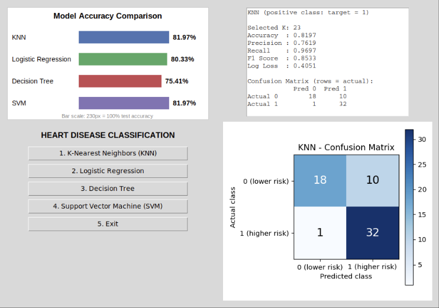
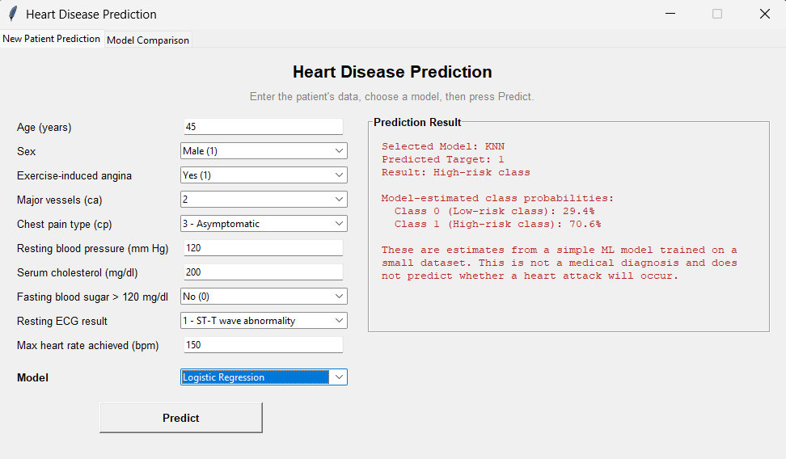
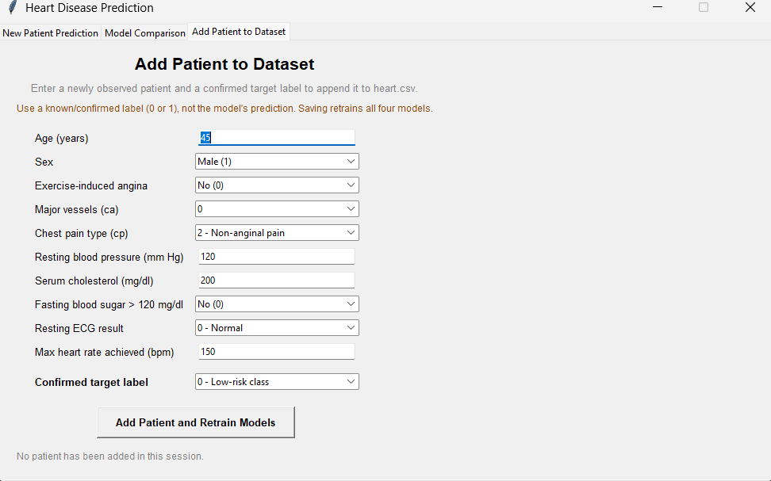
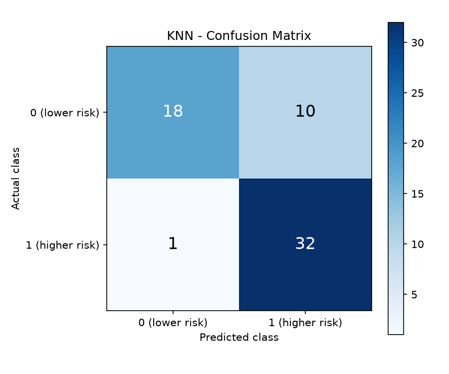
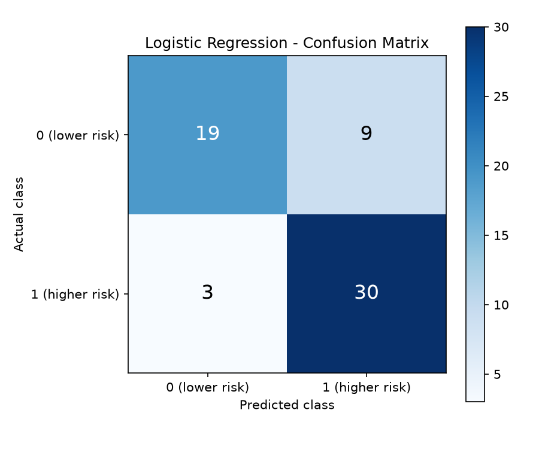
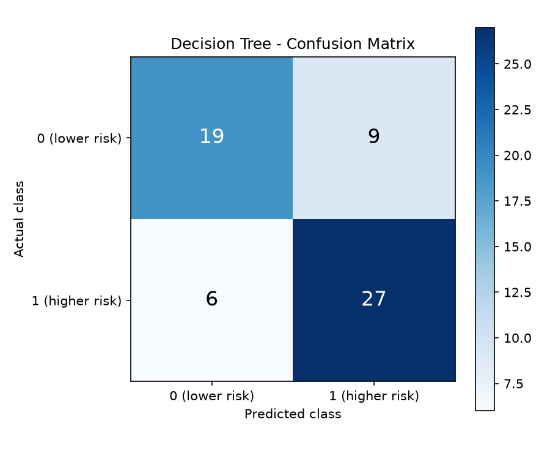
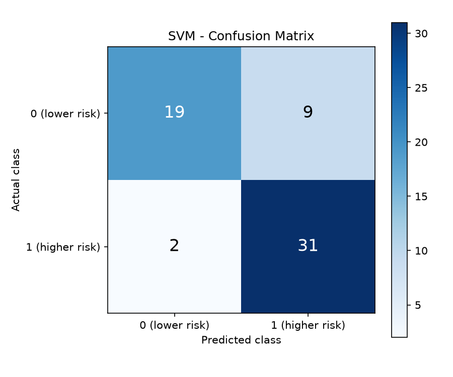

# Heart Disease Classification ❤️

A beginner-friendly Machine Learning project that predicts heart disease risk classes and compares four classification algorithms.

> **⚠️ Disclaimer:** This is an educational and practice project developed for learning Machine Learning. It is **not medically validated** and must not be used for real-world medical diagnosis, treatment decisions, or clinical purposes.

## 🖥️ GUI Preview

<table>
  <tr>
    <td align="center"></td>
    <td align="center"></td>
    <td align="center"></td>
  </tr>
</table>

## 🩺 Patient Prediction & Dataset Management

- Predict patient risk: `0` (Low Risk) or `1` (High Risk).
- Add new patients directly through the GUI and save records to `heart.csv`.
- Select the verified class label (`0` or `1`) for each new patient.
- Automatically retrain all four models and update performance comparisons.

## 📊 Model Comparison

<table>
  <tr>
    <td align="center"><b>KNN</b></td>
    <td align="center"><b>Logistic Regression</b></td>
    <td align="center"><b>Decision Tree</b></td>
    <td align="center"><b>SVM</b></td>
  </tr>
  <tr>
    <td></td>
    <td></td>
    <td></td>
    <td></td>
  </tr>
</table>

Models are evaluated using Accuracy, Precision, Recall, F1 Score, Log Loss, and Confusion Matrices.

### 🏆 Best Performing Model: KNN

Based on the evaluation results, **K-Nearest Neighbors (KNN)** achieved the best overall performance for identifying the high-risk class (`1`), considering Accuracy, Recall (Sensitivity), and F1 Score among the evaluated models.

These results apply only to the dataset and evaluation setup used in this educational project. They do not establish clinical accuracy or medical reliability.

## ⚙️ Installation & Usage

```bash
pip install pandas numpy matplotlib scikit-learn
python main.py
```

## 🛠️ Technologies

Python · Pandas · NumPy · Scikit-learn · Matplotlib
